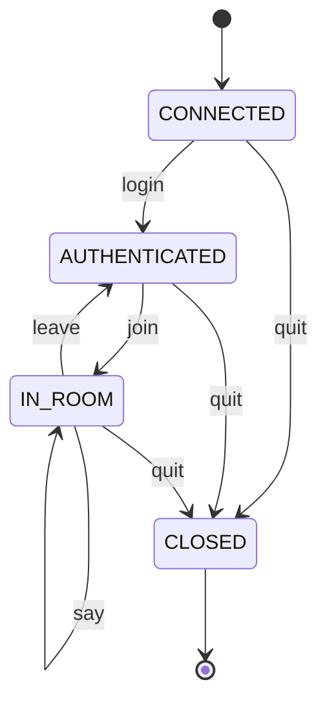

# StateChat

A small WebSocket chat server whose protocol is enforced by **deterministic finite automata (DFAs)**.
Every rule, such as "you cannot chat before logging in" or "a command name is lowercase letters only",
is an explicit entry in a transition table, not a pile of `if` statements.

## How it works

One generic `DFA` class (`statechat/dfa.py`) is used twice:

1. **Command lexer** (`statechat/lexer.py`): a character-level DFA that reads each incoming line and decides
   whether it is plain chat text, a well-formed command, or malformed input. Characters are first mapped to
   classes (`slash`, `lower`, `argch`, `space`, `other`), and tokens are emitted as the automaton leaves the
   `CMD` and `ARG` states.
2. **Connection state machine** (`statechat/session.py`): each WebSocket connection owns a `Session` whose
   state moves through `CONNECTED -> AUTHENTICATED -> IN_ROOM -> CLOSED`. An event that has no transition in
   the current state (for example `join` before `login`) raises `InvalidTransition` and is rejected before any
   side effect happens.

`statechat/server.py` glues them together with `asyncio` and the `websockets` library: lex the line, ask the
state machine if the action is legal, then perform it (login, join, broadcast, leave, quit).

### Connection state machine



### Grammar accepted by the lexer

```
line := text | "/" name (SPACE+ arg)* SPACE*
name := [a-z]+
arg  := [A-Za-z0-9_-]+
text := any line that does not start with "/"
```

## Run it

```bash
pip install -r requirements.txt
python -m statechat            # serves ws://localhost:8765  (optional: python -m statechat 9000)
```

### Run with Docker

```bash
docker compose up --build      # serves ws://localhost:8765
# or, without compose:
docker build -t statechat .
docker run --rm -p 8765:8765 statechat
```

Then open `client.html` in two browser tabs and try:

```
/login alice
/join dev
hello everyone
/leave
/quit
```

Chatting before logging in, joining twice, duplicate names, unknown commands and malformed input
(`/Login bob`, `/join a/b`) all return a clear `ERROR:` message.

## Tests

```bash
python -m pytest -q
```

18 tests cover the generic DFA, the lexer (valid and malformed commands), every legal and illegal session
transition, and an end-to-end test with two real WebSocket clients.

## Project layout

```
statechat/dfa.py       generic DFA engine (+ Mermaid export)
statechat/lexer.py     command lexer as a DFA
statechat/session.py   per-connection state machine
statechat/server.py    asyncio WebSocket server
client.html            minimal browser client
tests/                 unit and end-to-end tests
```

## Ideas to extend

- Add a `/msg <user>` private-message command (extend the lexer grammar and the transition table).
- Use `DFA.to_mermaid()` to generate the diagrams automatically in CI.
- Add heartbeat/idle timeout as a new state (`IDLE`) with its own transitions.
